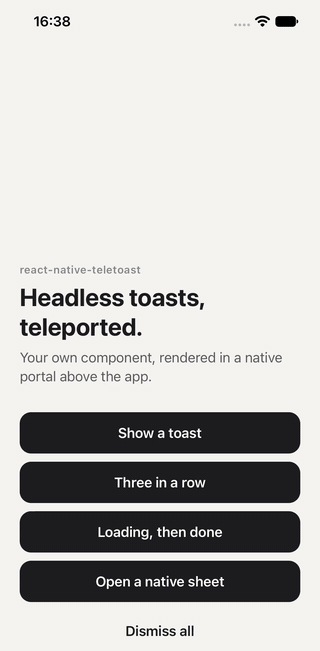

# react-native-teletoast

Headless toasts for React Native, rendered through
[react-native-teleport](https://github.com/kirillzyusko/react-native-teleport).

- **Bring your own toast.** Teletoast positions, stacks, animates, times and
  swipes toasts. What they look like is entirely your component: no icons, no
  themes, no `react-native-svg`.
- **Teleported, not overlaid.** Toasts render in a native portal host on top
  of your app. Mount a `<ToastHost />` in a native modal and the toasts on
  screen move into it, without remounting: same timer, same animation.
- **sonner-native's API** for what matters: `toast.custom()`, `toast.dismiss()`,
  ids to update a toast in place, `duration`, `onDismiss`, `onAutoClose`.
- Runs on the UI thread: Reanimated 4 for motion, Gesture Handler 3 for the
  swipe. Respects Reduce Motion (fades, no travel).

<p align="center">
  
</p>

<p align="center">
  <sub>The <a href="example">example app</a> on iOS. <a href="docs/demo.mp4">Sharper as MP4</a>.</sub>
</p>

## Compatibility

| Platform | Status                                                                                                                                                   |
| -------- | -------------------------------------------------------------------------------------------------------------------------------------------------------- |
| iOS      | ✅ Tested on the iOS 27 simulator: stacking, swipe, buttons inside toasts, toasts carried into React Native `Modal` sheets and Expo Router modals.        |
| Web      | ✅ Tested with react-native-web 0.21 and Expo static rendering: rendering, clicks through the toast layer, dismissal.                                    |
| Android  | ✅ Tested on the Android 15 (API 35) emulator: stacking, swipe, buttons inside toasts, toasts carried into a React Native `Modal` and back.           |

Tested with Expo SDK 58, React Native 0.88, React 19.3, Reanimated 4.7,
Gesture Handler 3.3 and react-native-teleport 1.2.2.

Reanimated 4 needs the New Architecture. Expo Go can't run it:
react-native-teleport has native code, so use a development build
(`expo run:ios`, `expo run:android`).

## Install

```sh
bun add react-native-teletoast react-native-teleport react-native-reanimated react-native-worklets react-native-gesture-handler react-native-safe-area-context
```

| Peer dependency                  | Version   |
| -------------------------------- | --------- |
| `react-native-teleport`          | >= 1.2    |
| `react-native-reanimated`        | >= 4.0    |
| `react-native-worklets`          | >= 0.5    |
| `react-native-gesture-handler`   | >= 3.0    |
| `react-native-safe-area-context` | >= 4.0    |

## Setup

Mount one `<Toaster />` inside react-native-teleport's `PortalProvider`, under
a `GestureHandlerRootView`. If something in your app already renders a
`PortalProvider`, put the `Toaster` inside it rather than adding another one.

```tsx
import { GestureHandlerRootView } from "react-native-gesture-handler";
import { PortalProvider } from "react-native-teleport";
import { Toaster } from "react-native-teletoast";

export default function App() {
  return (
    <GestureHandlerRootView>
      <PortalProvider>
        <Navigation />
        <Toaster />
      </PortalProvider>
    </GestureHandlerRootView>
  );
}
```

Keep it at the root, in a parent that fills the screen. Teleport moves the
native views, but React Native still measures them where the `Toaster` is
declared, and `Pressable` uses that measure to accept a tap: a `Toaster`
nested in a smaller view gets buttons that ignore touches.

## Show a toast

Pass an element, or a function that receives `{ id, dismiss }`:

```tsx
import { toast } from "react-native-teletoast";

toast.custom(<Banner title="Saved" />);

toast.custom(
  ({ dismiss }) => (
    <Banner title="Couldn't upload" action="Retry" onPress={dismiss} />
  ),
  { duration: 6000 },
);
```

Teletoast centers each toast horizontally and leaves its size to you: give
your component a width (`"92%"`, a `maxWidth`...).

A typical app wraps it once:

```tsx
export const notify = (title: string) =>
  toast.custom(({ dismiss }) => <Banner title={title} onClose={dismiss} />);
```

### Update, dismiss

```tsx
const id = toast.custom(<Banner title="Uploading…" />, { duration: Infinity });

// Same id: updated in place, timer restarted.
toast.custom(<Banner title="Uploaded" />, { id });

toast.dismiss(id); // one toast
toast.dismiss(); // every toast
```

### Options

| Option        | Type                         | Default            |                                                  |
| ------------- | ---------------------------- | ------------------ | ------------------------------------------------ |
| `id`          | `string \| number`           | generated          | Reusing a visible id updates that toast.         |
| `duration`    | `number`                     | Toaster `duration` | Milliseconds. `Infinity` waits for a dismissal.  |
| `dismissible` | `boolean`                    | `true`             | Allows the swipe.                                |
| `onDismiss`   | `(id) => void`               |                    | Swiped away, or `toast.dismiss()`.               |
| `onAutoClose` | `(id) => void`               |                    | The timer ran out.                               |

A toast stops counting down while it's touched, and stays at least a second
after the finger lifts.

### Several toasts

Toasts list one under the other, newest closest to the edge, each with its
own timer.

- A new toast slides in while the others move away on the same curve and
  the same frame, so it never lands on top of them.
- Past `visibleToasts`, the oldest leaves with its exit animation, and its
  `onDismiss` is called.
- A toast that leaves frees its room right away: the ones behind it move up
  during its exit.

## `<Toaster />`

| Prop             | Type                                | Default        |                                                                  |
| ---------------- | ----------------------------------- | -------------- | ---------------------------------------------------------------- |
| `position`       | `"top-center" \| "bottom-center"`   | `"top-center"` |                                                                  |
| `duration`       | `number`                            | `4000`         |                                                                  |
| `visibleToasts`  | `number`                            | `3`            | A new toast past this count dismisses the oldest.                |
| `gap`            | `number`                            | `14`           | Space between stacked toasts.                                    |
| `offset`         | `number`                            | `8`            | Distance from the safe area (at least 8 points from the edge).  |
| `swipeToDismiss` | `boolean`                           | `true`         | Swipe toward the edge to dismiss: a short flick is enough.       |
| `hostName`       | `string`                            | `"root"`       | The `PortalHost` used when no `<ToastHost />` is mounted.        |

## Native modals: `<ToastHost />`

On iOS, a native modal is presented above the whole app, root portal host
included: a toast shown while it's open would sit behind it. Mount a
`<ToastHost />` in the modal. While it's mounted, toasts render inside it, with
the modal's own safe area; when it unmounts, they move back to the root host.

```tsx
<View style={{ flex: 1 }}>
  <ModalContent />
  <ToastHost />
</View>
```

With Expo Router or React Navigation, `screenLayout` gives every modal one:

```tsx
const withToastHost = ({ children, options }) =>
  options.presentation === "modal" ? (
    <>
      {children}
      <ToastHost />
    </>
  ) : (
    children
  );

<Stack screenLayout={withToastHost} />;
```

The most recently mounted host wins.

When a native modal closes, the toasts inside it leave with it, then show up
at the top of the screen once it's gone: the modal applies view changes only
after its closing animation.

## Web

Works with react-native-web, server rendering included: the `Toaster`
renders nothing until a toast exists.

## Example app

[`example/`](example) is an Expo app that runs the library straight from
`src/`, with a native sheet to see toasts travel in and out.

```sh
cd example
bun install
bun run ios       # or: bun run android
```

## Differences with sonner-native

- No built-in toasts: `toast.success()`, `toast.error()`, `toast.promise()`,
  icons, themes and rich colors are yours to build.
- `offset` adds to the safe area instead of replacing it.
- One `Toaster` per app, no named toasters.
- No collapsed stack: toasts list one under the other.

## Local development

```sh
bun install         # also builds lib/
bun run typecheck
bun test
bun run pack:local  # builds and writes react-native-teletoast-<version>.tgz, what npm would publish
```

To try a local build in an app, depend on the tarball, not the folder: a
`file:` folder brings this repo's `node_modules`, so a second React.

```sh
bun add react-native-teletoast@file:../react-native-teletoast/react-native-teletoast-0.1.3.tgz
```

bun caches a local tarball by its path, so repacking the same version changes
nothing in the app. For a new local build, bump `version` here, run
`bun run pack:local`, then `bun add` the new file in the app.

## License

MIT
